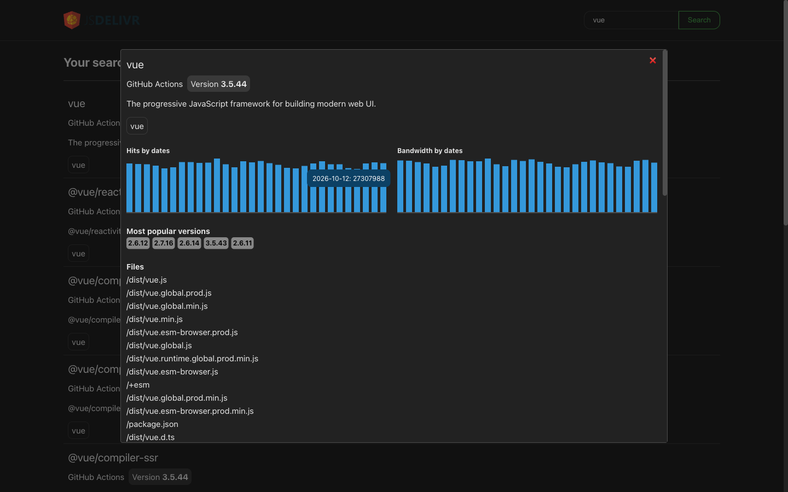
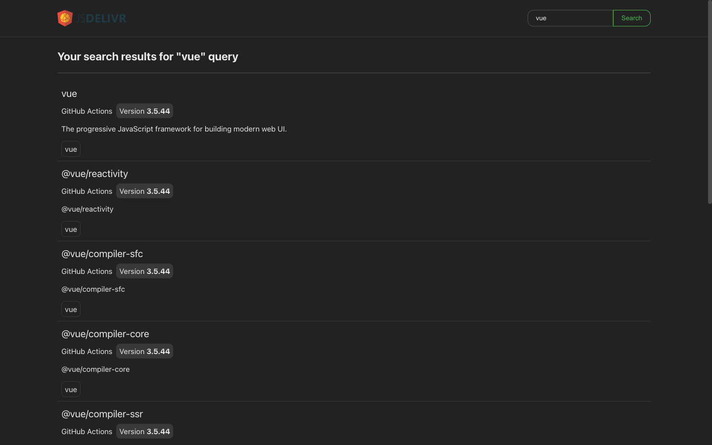
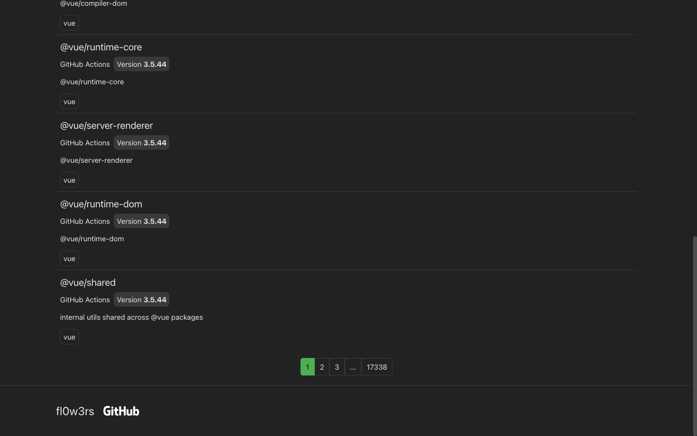

# Frozeneon test

A test assignment from 2024: an npm package search app with download statistics from jsDelivr, built with Vue 3 and TypeScript.



| | |
|---|---|
|  Search results |  Pagination |

## Features

- **Search** through the npm registry API, 10 packages per page, with pagination that shows the pages around the current one plus the first and last.
- **Package details** in a modal: daily hits and bandwidth charts, the most popular versions and the file list of the current version, all from the jsDelivr API.
- **Bar chart** written from scratch (no chart library), with a tooltip that stays on screen.
- **Page cache**: pages are cached per query, so going back to a page doesn't refetch it.
- **Stale responses** from an older search are ignored, so a slow request can't overwrite newer results.
- **Error, loading and empty states**. If one of the jsDelivr requests fails, the modal still shows the data that did load.

## Stack

Vue 3 (Composition API, `<script setup>`), TypeScript, Pinia, Vite, SCSS, ESLint, Prettier.

## Structure

```
src/
  api/             npm and jsDelivr API clients with response types
  stores/search.ts search state: results, pagination, cache
  pages/           search page
  components/      search result card, package modal, bar chart
```

## Running

API URLs and the page size are set in `.env`.

```sh
yarn install
yarn dev        # development server
yarn build      # type check and production build
yarn lint
```
